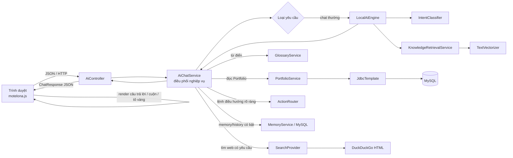

# 08 — HỌC JAVA, SPRING BOOT VÀ MYSQL QUA CODE MOTELONA

Tài liệu này giúp bạn học và thuyết trình đồ án bằng cách lần theo code thật. Hãy mở project `Project/1/motelona-ai/backend/` trong VS Code và đi theo thứ tự bên dưới. Tên lớp, method, endpoint và cấu hình được giữ nguyên như mã nguồn.

> **Cách giới thiệu chính xác:** MoteLona là trợ lý website viết bằng Java, dùng bộ phân loại ý định, từ điển thuật ngữ và truy xuất văn bản cục bộ bằng TF-IDF/cosine similarity. Phần xử lý hội thoại hiện tại là thuật toán và luật do dự án tự xây; nó không phải LLM tổng quát và không gọi API AI. Tìm web là nhánh riêng, chỉ chạy khi khách chủ động bật hoặc yêu cầu; backend lấy tiêu đề/trích đoạn từ trang HTML công khai của DuckDuckGo.

## 1. Bài giới thiệu ngắn

> “Đồ án của em là MoteLona, trợ lý AI tích hợp vào website Portfolio. Frontend gửi câu hỏi và ngữ cảnh trang đến REST API Java Spring Boot. Backend kiểm tra yêu cầu, phân loại ý định, truy xuất những đoạn liên quan và tạo câu trả lời theo luật. Dữ liệu Portfolio, lịch sử và bộ nhớ được lưu trong MySQL theo các chế độ tương ứng. Trợ lý có thể giải thích một số thuật ngữ, tìm web khi người dùng yêu cầu, hoặc gửi lệnh điều hướng tới các mục được cho phép để giao diện cuộn tới và tô vàng nội dung. Phiên bản hiện tại không dùng LLM/API AI; vì vậy câu trả lời dựa vào dữ liệu sẵn có và cần nói rõ khi không tìm thấy bằng chứng.”

Nếu giảng viên hỏi “AI ở đây là AI gì?”, nhấn mạnh đây là **hệ thống NLP cục bộ theo luật và truy xuất**, không phải AI tạo sinh. Không nói MoteLona tự học, hiểu như con người hay xác minh toàn bộ trang Internet.

## 2. Bản đồ kiến trúc: đọc từ request đến response



### Các nhóm thư mục cần nhận biết

| Nhóm | Vai trò | File nên mở |
|---|---|---|
| Khởi động | Tạo Spring application | `.../MotelonaApplication.java` |
| REST controller | Nhận HTTP request, gọi service, trả JSON | `.../controller/AiController.java`, `PortfolioController.java`, `MemoryController.java` |
| DTO | Định nghĩa dữ liệu request/response | `.../dto/ChatRequest.java`, `ChatResponse.java`, `UiAction.java` |
| Nghiệp vụ | Điều phối chat, dữ liệu Portfolio, điều hướng, giới hạn | `.../service/AiChatService.java`, `PortfolioService.java`, `ActionRouter.java`, `RateLimitService.java` |
| NLP cục bộ | Phân loại và truy xuất văn bản | `.../ai/IntentClassifier.java`, `TextVectorizer.java`, `KnowledgeRetrievalService.java`, `LocalAiEngine.java` |
| MySQL memory/history | Lưu dữ liệu theo session và consent | `.../memory/MemoryService.java`, `PortfolioService.java` |
| Tìm web | Gửi truy vấn và phân tích kết quả HTML | `.../search/SearchProvider.java`, `DuckDuckGoHtmlSearchProvider.java` |
| Cấu hình | CORS, lỗi API, security headers | `.../config/CorsConfig.java`, `ApiExceptionHandler.java`, `ApiSecurityHeadersFilter.java` |
| Cấu hình chạy | Java version, dependencies, DB, port | `backend/pom.xml`, `backend/src/main/resources/application.yml` |
| Database | Schema mới và migration database cũ | `database/PortfolioAI_MySQL.sql`, `database/V002_BilingualContent_MySQL.sql`, `backend/src/main/resources/schema.sql` |

## 3. Lộ trình học qua code

1. **Đọc `MotelonaApplication.java`:** hiểu entry point Java và `@SpringBootApplication`.
2. **Đọc DTO trước controller:** xem JSON được ánh xạ vào `ChatRequest` và kết quả trong `ChatResponse` ra sao.
3. **Theo `AiController.chat()` đến `AiChatService.chat()`:** hiểu HTTP, dependency injection, validation, rate limit và các nhánh nghiệp vụ.
4. **Theo nhánh trả lời thường:** đọc `LocalAiEngine` → `IntentClassifier` → `KnowledgeRetrievalService` → `TextVectorizer`.
5. **Theo nhánh MySQL:** đọc `PortfolioService.publicPortfolio()` và `aiContext()`, sau đó đối chiếu với bảng trong schema.
6. **Đọc nhánh điều hướng, giải thích và tìm web:** `ActionRouter`, `GlossaryService`, `DuckDuckGoHtmlSearchProvider`.
7. **Đọc cấu hình và kiểm thử:** `application.yml`, config classes và `src/test/java`.

Khi đọc một method, hãy trả lời bốn câu: **đầu vào là gì, kiểm tra gì, gọi lớp nào tiếp theo, đầu ra hoặc lỗi là gì?** Đây cũng là cách trả lời phản biện rõ ràng.

## 4. Java nền tảng thể hiện trong đồ án

### 4.1 Class, object, encapsulation và constructor

Ví dụ trong `AiChatService`:

```java
private final LocalAiEngine localAi;

public AiChatService(LocalAiEngine localAi, JdbcTemplate jdbc, ...) {
    this.localAi = localAi;
}
```

`AiChatService` là class; Spring tạo object của class đó. Trường `private` che giấu chi tiết bên trong; `final` nghĩa là sau constructor không thể gán sang dependency khác. Constructor injection đưa các phụ thuộc vào class một cách rõ ràng, thuận lợi cho kiểm thử.

### 4.2 Interface và đa hình

`SearchProvider` quy định khả năng tìm kiếm; `DuckDuckGoHtmlSearchProvider` triển khai interface đó. `AiChatService` nhận kiểu `SearchProvider`, do đó nghiệp vụ phụ thuộc vào hợp đồng thay vì buộc chặt vào cách tìm kiếm cụ thể. Có thể thay provider bằng implementation khác mà ít phải sửa orchestration.

### 4.3 Enum, record, collection và generics

- `IntentClassifier.Intent` là `enum`: danh sách ý định có giới hạn như `SKILLS`, `PROJECTS`, `GENERAL`.
- `Classification`, `Passage`, `SearchResult`, `ChatRequest` là các `record`: kiểu dữ liệu gọn, phù hợp giữ dữ liệu truyền giữa lớp.
- `List<Passage>` là danh sách các đoạn; `Map<String, Object>` biểu diễn một tập trường có tên; generic `<T>` giúp kiểm tra kiểu lúc biên dịch.
- `Map<Intent, List<String>>` trong `IntentClassifier` lưu ví dụ theo từng ý định.

### 4.4 Lambda, Stream và biểu thức switch

Trong retrieval, code dùng `stream().sorted(...).limit(...).toList()` để sắp xếp kết quả theo điểm và lấy số lượng giới hạn. Lambda như `p -> p.score()` là hàm ngắn truyền cho stream. `switch` expression trong `LocalAiEngine` ánh xạ `Intent` thành câu mở đầu, đồng thời compiler buộc xử lý các nhánh rõ ràng.

### 4.5 Exceptions và resource management

`IllegalArgumentException` báo dữ liệu request không hợp lệ; `AiUnavailableException` và `SearchUnavailableException` diễn tả lỗi dịch vụ. `ApiExceptionHandler` chuyển lỗi thành HTTP response. `try-with-resources` trong search provider đảm bảo đóng `InputStream` kể cả khi gặp lỗi.

### 4.6 HTTP client, regex và thư viện chuẩn

`DuckDuckGoHtmlSearchProvider` dùng `java.net.http.HttpClient` của JDK để gửi HTTPS request; regex được dùng để chuẩn hóa/lọc chuỗi; `Duration` định nghĩa timeout. Đây là Java chuẩn, còn Spring quản lý vòng đời các component và REST API.

## 5. NLP cục bộ hoạt động thế nào?

### 5.1 Bước 1 — Chuẩn hóa và tách token

`TextVectorizer.normalize()`:

1. chuyển chữ thường;
2. đổi `đ` thành `d`;
3. tách dấu tiếng Việt bằng Unicode normalization;
4. bỏ ký tự không phải chữ/số và chuẩn hóa khoảng trắng.

`tokens()` tách thành từ, bỏ stop words như “là”, “của”, “the”, “is”, sau đó thêm một số bigram (cụm hai từ liên tiếp) như `ky_nang`, giúp cụm tiếng Việt quan trọng giữ được ngữ nghĩa cơ bản.

### 5.2 Bước 2 — Phân loại ý định

`IntentClassifier.classify()` trước tiên thử cụm từ luật rõ ràng qua `explicitIntent()`. Nếu khớp, confidence là `1.0`. Nếu không, code so sánh câu với ví dụ có sẵn theo từng nhóm bằng vector similarity. Điểm tốt nhất từ `0.20` trở lên được chọn; thấp hơn thì xếp là `GENERAL`.

Ý định là nhãn của loại yêu cầu, ví dụ chào hỏi, hỏi kỹ năng, dự án, học vấn, liên hệ hoặc CV. Đây không phải mô hình đã huấn luyện trên bộ dữ liệu lớn; ví dụ và luật được viết trong source.

### 5.3 Bước 3 — Chấm độ liên quan

`TextVectorizer.similarity()` biến câu hỏi và đoạn văn thành vector TF-IDF rồi tính cosine similarity.

- **TF (Term Frequency):** tần suất một token trong văn bản, code dùng `1 + ln(count)`.
- **IDF (Inverse Document Frequency):** tăng trọng số của token ít xuất hiện trong corpus; code dùng `ln(1 + (N + 1)/(1 + df))`.
- **Cosine similarity:** so góc giữa hai vector; càng gần 1 thì hướng càng giống. Đây là tín hiệu liên quan, không phải xác suất câu trả lời đúng.
- Code còn tính `overlap()` để đo mức trùng token trực tiếp.

`KnowledgeRetrievalService` chia context thành các passage, kết hợp điểm theo công thức:

```text
score = 0.72 × TF-IDF/cosine + 0.28 × token overlap + section boost
```

Điểm boost `0.24` có thể được cộng khi passage mở đầu bằng nhóm mục phù hợp. Engine lọc passage thấp hơn ngưỡng rồi chỉ dùng một số kết quả cao nhất. Các ngưỡng là heuristic được code chọn, **không phải độ tin cậy đã hiệu chuẩn**.

### 5.4 Bước 4 — Tạo câu trả lời có căn cứ

`LocalAiEngine.chat()` ưu tiên lời chào/cảm ơn/giới thiệu khả năng và từ điển. Với câu hỏi dữ liệu, engine tìm passage; `groundedAnswer()` trả các đoạn liên quan theo ngôn ngữ EN/VI và nhắc rằng nó chỉ dùng dữ liệu hiện có. Nếu thiếu căn cứ, câu trả lời nói chưa đủ thông tin thay vì đoán.

Phần diễn đạt được ghép bằng template Java, không sinh câu bằng LLM. Vì vậy nên gọi đây là **trợ lý NLP/truy xuất cục bộ**, không gọi là mô hình AI tạo sinh.

## 6. Spring Boot và REST API

### 6.1 Spring Boot làm gì trong ứng dụng?

`MotelonaApplication.main()` gọi `SpringApplication.run(...)`. `@SpringBootApplication` bật cấu hình tự động và component scanning. Spring tìm các class có `@RestController`, `@Service`, `@Component`, tạo object và kết nối chúng trong application context.

### 6.2 Dependency Injection (DI)

Controller nhận service qua constructor; service nhận engine, `JdbcTemplate` và provider qua constructor. Đây là DI: framework cung cấp dependency thay vì class tự `new` toàn bộ đối tượng. Lợi ích là giảm phụ thuộc cứng, dễ thay implementation và mock khi test.

### 6.3 Controller, DTO, HTTP và JSON

Trong `AiController`:

- `@RestController` trả dữ liệu, thường được serialize thành JSON.
- `@RequestMapping("/api/ai")` đặt prefix.
- `@PostMapping("/chat")` nhận POST `/api/ai/chat`.
- `@RequestBody ChatRequest` yêu cầu Jackson chuyển JSON thành Java record.
- Giá trị trả về như `ChatResponse` được serialize thành JSON response.

Controller chủ yếu nhận request, gọi rate limiter và service; thuật toán không nên đặt hết vào controller. Service giữ orchestration và nghiệp vụ.

### 6.4 Endpoint chính

| Endpoint | Mục đích |
|---|---|
| `GET /api/ai/health` | Trạng thái backend/engine và provider tìm web. |
| `POST /api/ai/chat` | Chat, điều hướng có kiểm soát hoặc tìm web theo yêu cầu rõ ràng. |
| `POST /api/ai/explain` | Giải thích thuật ngữ/đoạn được chọn. |
| `POST /api/ai/search` | Tìm trong ngữ cảnh trang được gửi lên. |
| `GET /api/ai/search/web?query=...` | Truy vấn web; có rate limit và giới hạn ký tự. |
| `/api/ai/memories` | Đọc/lưu/xóa memory theo session và consent. |
| `/api/ai/history/{sessionId}` | Đọc/xóa lịch sử chat theo session. |
| `/api/ai/export/{sessionId}` | Xuất dữ liệu session. |
| `GET /api/portfolio/status` | Kiểm tra kết nối Portfolio/MySQL. |
| `GET /api/portfolio/public` | Trả dữ liệu Portfolio công khai. |
| `POST /api/portfolio/contact` | Lưu liên hệ, kiểm tra honeypot và rate limit. |

### 6.5 Cấu hình, lỗi và bảo vệ request

- `application.yml` lấy port, host MySQL, user/password và CORS từ environment variables. Mật khẩu không được đặt trong frontend.
- `CorsConfig` chỉ cho phép origin được cấu hình; wildcard `*` bị từ chối.
- `ApiExceptionHandler` chuyển lỗi đầu vào thành 400, rate limit thành 429, dịch vụ tạm unavailable thành 503, lỗi bất ngờ thành 500 mà không trả stack trace cho người dùng.
- `ApiSecurityHeadersFilter` giới hạn body khai báo 64 KB và thêm security headers cho API.
- `RateLimitService` dùng `ConcurrentHashMap`, an toàn khi nhiều thread trong **một instance**. Đây chưa phải rate limiter chia sẻ giữa nhiều máy chủ; khi scale nhiều instance cần gateway/Redis hay giải pháp dùng chung.

### 6.6 Maven dependencies và cấu hình MySQL

Mở `backend/pom.xml`:

- `spring-boot-starter-webmvc`: REST MVC và server web.
- `spring-boot-starter-jdbc`: tích hợp JDBC và `JdbcTemplate`.
- `mysql-connector-j` với scope `runtime`: driver kết nối MySQL lúc chạy ứng dụng.
- `spring-boot-starter-validation`: hỗ trợ Jakarta Bean Validation; một số quy tắc hiện được kiểm tra thủ công trong service.
- `spring-boot-starter-test`: JUnit/Spring/Mockito cho test.

Trong `application.yml`, datasource URL đọc `MYSQL_HOST`, `MYSQL_PORT`, `MYSQL_DATABASE`; tên đăng nhập/mật khẩu đọc `MYSQL_USERNAME`, `MYSQL_PASSWORD`. HikariCP là connection pool: giữ và tái sử dụng các kết nối DB thay vì mở một kết nối mới cho mỗi query. Cấu hình hiện đặt tối đa 10 kết nối, tối thiểu 2 kết nối idle. Không commit mật khẩu thật vào source.

## 7. MySQL và cách Java truy cập dữ liệu

### 7.1 Cơ sở dữ liệu quan hệ

MySQL lưu dữ liệu thành bảng; mỗi bảng có cột và bản ghi. Primary key định danh một hàng; foreign key đảm bảo quan hệ hợp lệ; unique key ngăn trùng; index giúp lọc/sắp xếp nhanh hơn nhưng làm tăng chi phí khi ghi.

Ví dụ: `SkillCategory` có nhiều `Skill`; `Project` liên kết nhiều `Technology` qua bảng nối `ProjectTechnology`. `AIConversation` có nhiều `AIMessage`. Schema cũng lưu `Education`, `Experience`, `ContactMessage`, knowledge items, lịch sử và bộ nhớ.

### 7.2 `JdbcTemplate`

`PortfolioService` dùng `JdbcTemplate` để chạy SQL trực tiếp. Một số query đọc dùng `queryForList`; query có tham số dùng dấu `?` để bind dữ liệu, ví dụ:

```java
jdbc.update("DELETE FROM user_memories WHERE session_id = ? AND id = ?", sessionId, id);
```

Bind parameter giúp tách dữ liệu người dùng khỏi câu SQL, giảm nguy cơ SQL injection. Không tự ghép input vào chuỗi SQL. Dự án dùng JDBC, **không dùng JPA/Hibernate làm ORM**.

### 7.3 Transaction

`@Transactional` trên `PortfolioService.archiveConversation()` yêu cầu các thao tác lưu hội thoại chạy trong transaction Spring. Transaction giúp nhóm thay đổi dữ liệu thành một đơn vị: khi gặp lỗi, có thể rollback để tránh trạng thái chỉ ghi được một phần.

### 7.4 Schema mới và database cũ

- Cài mới: chạy `database/PortfolioAI_MySQL.sql` để tạo database và bảng.
- Backend nạp `schema.sql` với `spring.sql.init.mode: always`; các câu `CREATE TABLE IF NOT EXISTS` giúp tạo bảng thiếu khi khởi động.
- `CREATE TABLE IF NOT EXISTS` **không thêm cột vào bảng đã tồn tại**. Database cũ phải sao lưu và chạy `database/V002_BilingualContent_MySQL.sql` trước khi chạy code mới.
- Các trường dịch như `TitleVi`, `SkillNameVi` là tùy chọn. Cần điền bản dịch có căn cứ; backend không tự dịch nội dung hồ sơ.

## 8. Tìm web, điều hướng và bộ nhớ

### Tìm web

`SearchProvider` là interface; `DuckDuckGoHtmlSearchProvider` gửi HTTPS request bằng `HttpClient`, đọc HTML công khai, dùng HTML parser để lấy tiêu đề, snippet và URL. Code có timeout, giới hạn query/kích thước phản hồi/số kết quả. Đây không phải search API chính thức hay tích hợp LLM; markup HTML của nhà cung cấp có thể đổi và server cần Internet outbound.

### Điều hướng website

`ActionRouter` chỉ hoạt động khi nhận thấy cụm từ yêu cầu điều hướng rõ ràng. Nó ánh xạ chủ đề vào danh sách page/section ID cố định rồi trả `UiAction`; frontend thực hiện scroll và highlight. Text người dùng không được biến thành JavaScript hay URL tùy ý.

### Lịch sử và memory

Lịch sử hội thoại chỉ lưu khi `historyEnabled` bật. Bảng `conversation_messages` giữ cửa sổ gần nhất (tối đa khoảng 200 dòng cho mỗi session); `AIConversation`/`AIMessage` là bản archive riêng. Memory dài hạn nằm trong `user_memories`, cần `memoryEnabled`/consent và câu lệnh ghi nhớ rõ ràng. `MemoryService` kiểm tra session ID, độ dài và từ chối lưu password, API key hoặc secret. Người dùng có thể đọc, xóa từng mục hoặc xóa toàn bộ. Không được nói memory tự bật nếu người dùng chưa đồng ý.

## 9. Cách trình bày luồng code khi bảo vệ

Để giải thích câu “Em có những kỹ năng nào?”, mở các file theo thứ tự này:

1. `frontend/motelona.js` gửi `ChatRequest` với câu hỏi, `language`, session, `websiteContext` và trạng thái privacy/search.
2. `AiController.chat()` nhận JSON, áp dụng giới hạn request rồi gọi `AiChatService.chat()`.
3. `AiChatService` xác thực độ dài, chuẩn hóa EN/VI và kiểm tra trước các nhánh web search, memory, navigation.
4. Nếu là chat thường, service bổ sung context từ trang và `PortfolioService.aiContext()` khi MySQL sẵn sàng.
5. `LocalAiEngine` gọi `IntentClassifier`; ý định phù hợp là `SKILLS`.
6. `KnowledgeRetrievalService` chia context thành đoạn và chấm điểm bằng `TextVectorizer`.
7. Engine chỉ trả các passage qua template có căn cứ; nếu không đủ điểm thì nói chưa tìm thấy dữ liệu.
8. `ChatResponse` thành JSON; frontend hiển thị câu trả lời. Nếu có `UiAction`, frontend mới thực hiện điều hướng/highlight.

Khi giải thích database, mở thêm `PortfolioService.publicPortfolio()` để cho thấy Java đọc bằng SQL, sau đó đối chiếu bảng `Skill`/`SkillCategory` trong schema.

## 10. Kịch bản thuyết trình mẫu khoảng 5 phút

**Mở đầu:** “Em xây dựng MoteLona, trợ lý website dành cho Portfolio. Mục tiêu là giúp khách xem thông tin nhanh hơn bằng hỏi đáp, giải thích thuật ngữ, điều hướng tới phần liên quan và tìm web có chủ động.”

**Công nghệ:** “Backend dùng Java 21 và Spring Boot để cung cấp REST API. Dữ liệu portfolio, liên hệ, lịch sử và memory lưu trong MySQL. Frontend JavaScript gửi JSON đến backend. Em dùng `JdbcTemplate` để truy vấn SQL.”

**Kiến trúc:** “Request đi từ `AiController` đến `AiChatService`. Controller tiếp nhận HTTP; service điều phối nghiệp vụ; `LocalAiEngine` xử lý câu hỏi; `PortfolioService` truy cập MySQL. Các lớp được nối bằng constructor dependency injection.”

**Phần NLP:** “Engine chuẩn hóa tiếng Việt/Anh, tách token, bỏ từ ít giá trị và thêm một số bigram. `IntentClassifier` nhận diện nhóm yêu cầu bằng luật cụm từ hoặc so với ví dụ. Sau đó `KnowledgeRetrievalService` xếp hạng đoạn bằng TF-IDF/cosine kết hợp độ trùng từ. Kết quả được ghép bằng template Java.”

**MySQL:** “Schema có khóa chính, khóa ngoại, unique key và index. Ví dụ kỹ năng liên kết với nhóm kỹ năng; công nghệ dự án qua bảng nối. Java dùng `JdbcTemplate` và parameter binding. Khi ghi history/memory, hệ thống kiểm soát session và consent.”

**Giới hạn và kết luận:** “Đây là NLP/truy xuất tự xây, không phải LLM và không tự học. Tìm web chỉ chạy theo yêu cầu, chỉ đưa tiêu đề/snippet/nguồn; người dùng cần tự kiểm chứng. Khi không có căn cứ, engine trả lời rằng chưa tìm thấy. Hướng phát triển tiếp theo là mở rộng dữ liệu kiểm thử và glossary, đồng thời đánh giá truy xuất trên các câu hỏi thực tế.”

## 11. Câu hỏi giảng viên có thể hỏi

**“Tại sao gọi là AI nếu không có LLM?”**  
“Trong đồ án, AI là xử lý ngôn ngữ tự nhiên theo luật và thuật toán xếp hạng văn bản. Em mô tả đúng phạm vi là trợ lý NLP/truy xuất cục bộ, không khẳng định là mô hình tạo sinh.”

**“TF-IDF là gì?”**  
“TF tăng theo số lần từ xuất hiện trong một đoạn; IDF tăng trọng số từ ít phổ biến trong tập tài liệu. Nhân hai phần giúp từ phân biệt tốt hơn đóng góp nhiều vào vector.”

**“Cosine similarity có nghĩa là xác suất đúng không?”**  
“Không. Đây là độ giống hướng giữa vector. Nó giúp xếp hạng mức liên quan, nhưng điểm cao không chứng minh thông tin đúng; vì vậy hệ thống giữ passage nguồn và dùng ngưỡng.”

**“`IntentClassifier` học từ dữ liệu nào?”**  
“Phiên bản này dùng các ví dụ và cụm luật được khai báo trong code. Không có bước training model hay pipeline machine learning.”

**“Spring Boot giúp gì?”**  
“Spring Boot tự cấu hình nhiều thành phần ứng dụng, tạo embedded server và quản lý component. Trong project, annotation REST tạo endpoint, component scanning tìm service và DI nối dependency.”

**“Vì sao dùng `JdbcTemplate` thay JPA?”**  
“Đồ án hiện dùng SQL tường minh qua `JdbcTemplate`, nên truy vấn và quan hệ nhìn thấy rõ. Project không dùng JPA/Hibernate; nếu đổi ORM thì cần đánh giá truy vấn, mapping và migration đồng bộ.”

**“Làm sao tránh SQL injection?”**  
“Query có dữ liệu đầu vào dùng bind parameter `?` của JDBC. Không ghép chuỗi input trực tiếp vào SQL. Tên bảng/cột trong code là cố định.”

**“MySQL tự tạo schema lúc nào?”**  
“Spring SQL init chạy `schema.sql` khi backend khởi động và tạo bảng còn thiếu. Nhưng câu `IF NOT EXISTS` không nâng cấp cột cũ; database cũ chạy migration riêng trước.”

**“Điều hướng của AI có thể mở bất kỳ link nào không?”**  
“Không. `ActionRouter` chọn target từ allow-list page/section ID. Frontend xử lý action có kiểu `navigate`; không chạy JavaScript từ nội dung người dùng.”

**“Tìm web có đảm bảo câu trả lời đúng không?”**  
“Không. Provider đọc kết quả HTML công khai và trả nguồn để người dùng mở kiểm tra. Markup có thể thay đổi, mạng server có thể lỗi và snippet thiếu ngữ cảnh.”

**“Rate limit này dùng được khi có nhiều server không?”**  
“Nó giữ bộ đếm trong `ConcurrentHashMap` của từng process, nên phù hợp mức bảo vệ cơ bản một instance. Nếu triển khai nhiều instance, cần limiter dùng chung như gateway hoặc Redis.”

**“Memory và history khác nhau thế nào?”**  
“History là các lượt hội thoại được giữ ngắn hạn khi bật history. Memory là ghi chú dài hạn, chỉ lưu khi người dùng đồng ý và yêu cầu ghi nhớ. Cả hai gắn với session và có thao tác xóa.”

**“Em đã kiểm thử đến đâu?”**  
“Bộ test hiện kiểm tra các phần như phân loại ý định, retrieval/engine, điều hướng, glossary, search parsing, validation và schema contract. Test schema không thay cho kiểm thử với một MySQL server thật; browser/API end-to-end cần được chạy riêng.”

## 12. Từ vựng EN–VI nên nhớ

| Thuật ngữ | Cách nói ngắn |
|---|---|
| Dependency Injection | Tiêm phụ thuộc: framework cung cấp object cần dùng. |
| REST endpoint | Điểm cuối HTTP mà frontend gọi. |
| DTO / record | Cấu trúc dữ liệu request hoặc response. |
| Tokenization | Tách văn bản thành token. |
| Intent classification | Phân loại ý định người dùng. |
| Retrieval | Truy xuất đoạn thông tin phù hợp. |
| Grounded answer | Câu trả lời dựa trên nguồn cụ thể. |
| Prepared statement | Câu SQL dùng tham số bind riêng. |
| Primary / foreign key | Khóa chính / khóa ngoại. |
| Transaction | Nhóm thao tác dữ liệu có commit/rollback. |
| CORS | Quy tắc origin nào được phép gọi API từ trình duyệt. |
| Rate limit | Giới hạn số request trong khoảng thời gian. |
| Consent | Sự đồng ý rõ ràng của người dùng. |

## 13. Kiểm tra kiến thức trước buổi bảo vệ

- [ ] Tự vẽ lại luồng `motelona.js` → Controller → Service → Engine/DB → JSON.
- [ ] Tự giải thích vì sao MoteLona không phải LLM.
- [ ] Nêu được khác nhau giữa intent classification và retrieval.
- [ ] Nói được TF, IDF, cosine similarity và giới hạn của điểm số.
- [ ] Mở được `ChatRequest`, `ChatResponse`, `AiController`, `AiChatService`, `LocalAiEngine`.
- [ ] Mở được một query trong `PortfolioService` và chỉ ra parameter binding.
- [ ] Phân biệt create schema mới với migration database cũ.
- [ ] Nói rõ tìm web, history và memory có giới hạn/điều kiện gì.
- [ ] Không tuyên bố đã kiểm thử production, MySQL thật hoặc browser nếu chưa chạy.

### Nhóm test tham khảo trong source

Test Java nằm ở `backend/src/test/java/com/motelona/assistant/`. Các file tiêu biểu: `IntentClassifierTest`, `LocalAiEngineTest`, `ActionRouterTest`, `GlossaryServiceTest`, `DuckDuckGoHtmlSearchProviderTest`, `PortfolioServiceTest` và `MySqlSchemaContractTest`. Mở test để xem dữ liệu đầu vào và hành vi mong đợi; test contract của schema chỉ đọc file SQL, không khởi động MySQL.
